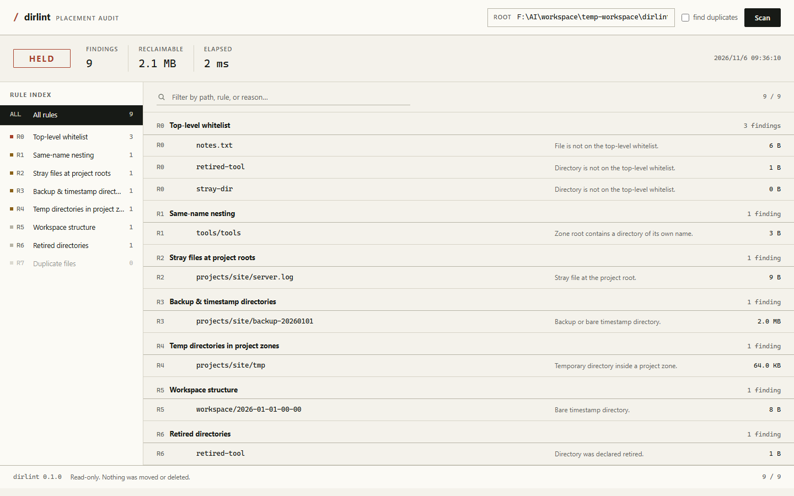

# dirlint

Read-only placement audit for a workspace directory tree.

`dirlint` checks a directory against placement rules you define — which top-level
entries are allowed, where project artifacts live, where process files belong,
which folders are retired — and reports every violation with a size estimate and
a concrete fix. It never moves or deletes anything.

It exists because a workspace shared by several projects, tools, and agents
accumulates scratch scripts, logs, backups, and duplicate copies until nobody
can tell which copy is canonical.



## Install

```bash
pip install -e .
# or run without installing:
python -m dirlint.cli scan --root . --config examples/dirlint.json
```

No dependencies outside the Python standard library. Python 3.11+.

## Use

```bash
# terminal report (exit code 1 when findings exist)
dirlint scan --root /path/to/workspace --config examples/dirlint.json

# machine-readable
dirlint scan --root . --config examples/dirlint.json --json

# also hash project/tool files to find byte-identical copies
dirlint scan --root . --config examples/dirlint.json --duplicates

# local web UI at http://127.0.0.1:8765
dirlint serve --root /path/to/workspace --config examples/dirlint.json

# create a compliant task directory in the process workspace
dirlint new-task "import legacy assets" --workspace /path/to/workspace/temp-workspace
```

## Rules

| ID | Checks |
|---|---|
| R0 | Top-level whitelist: only configured entries may live at the root |
| R1 | Same-name nesting (`tools/tools`) — a move went wrong |
| R2 | Stray files at project roots: logs, backups, temp files, images, archives |
| R3 | Backup and bare timestamp directories outside the archive |
| R4 | `temp` / `tmp` / `downloads` / `_scratch` inside project or tool roots |
| R5 | Unregistered directories inside the workspace zone |
| R6 | Directories declared retired but still occupying space |
| R7 | Byte-identical duplicate files (opt-in, `--duplicates`) |

## Config

One JSON file. Paths are relative to `--root`. Unknown keys are ignored; missing
keys fall back to the defaults in `dirlint/core.py`.

```json
{
  "allowedTop": ["projects", "tools", "workspace", "docs"],
  "ignoredTop": ["$RECYCLE.BIN"],
  "zones": {
    "projects": ["projects"],
    "tools": ["tools"],
    "workspace": ["workspace"],
    "archive": ["docs/archive"],
    "cache": ["cache"]
  },
  "workspaceAllowed": ["temp", "temp-workspace"],
  "retired": ["old-tool"],
  "rules": { "duplicates": false },
  "duplicates": { "minBytes": 1048576 }
}
```

Zones drive the rules: a rule whose zone list is empty is simply skipped, so the
defaults assume nothing about an unknown workspace.

## Design

- **Report, never mutate.** Every finding carries its fix as text.
- **Convention lives in config**, not in code.
- **Stdlib only**, offline, localhost UI.
- **Evidence over claims:** each rule states what it checks and why.

## Development

```bash
python -m unittest discover -s tests -v
```

## License

MIT. See [LICENSE](LICENSE).

---

## 中文

工作区落位审计工具：按一份 JSON 规则检查目录树，报告违规项、体积和建议动作，
**只读、不移动、不删除**。

```bash
pip install -e .
dirlint scan --root "F:/" --config my-config.json
dirlint serve --root "F:/" --config my-config.json   # 本地网页 UI
```

规则：顶层白名单、同名嵌套、项目根散文件、备份/时间戳目录、项目区临时目录、
工作区结构、退役目录、重复文件（可选）。配置里的 zone 为空时对应规则自动跳过，
因此对陌生目录不做任何假设。
